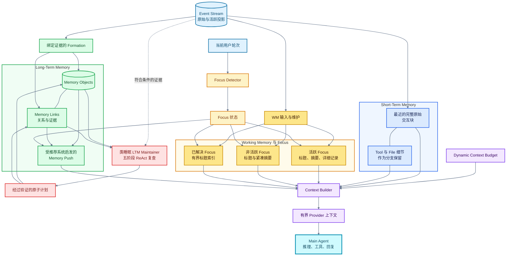

[English](README.md) | **简体中文**

# Sema

**一个持久化、记忆原生的 AI Agent。**

> **超越会话，超越上下文窗口。**
> Sema 将对话视为交互界面，而不是 Agent 记忆的边界。

Sema 是一个以原创 Memory Engine 为核心、Windows 优先的实验性 AI Agent。它并非把记忆作为通用数据库或召回工具附加到 Agent 上，而是将记忆、注意力、上下文构建和 Agent Runtime 作为一个整体共同设计。

> **Memory 不只是 Sema 调用的一项工具。它是 Runtime 的一部分，并决定 Sema 能感知到什么。**

Memory Engine 保留来源证据，维护不同层次的活跃状态，自动激活相关的长期上下文，并在 Main Agent 的注意力之外完成大部分记忆工作。Main Agent 因此可以专注于理解用户、推理和行动，而不必持续判断何时以及如何管理记忆。

## Sema 为何存在

许多 Agent 围绕一次会话和一个模型上下文窗口组织：

```text
开始对话 -> 填满上下文窗口 -> 总结或截断 -> 重新开始
```

这种模式把管理记忆的责任交给了用户：用户必须记得某条信息在哪个会话里、决定何时召回旧信息，并在新任务或新会话开始时重新解释上下文。记忆插件能够提供帮助，但 Agent 通常仍需先意识到信息缺失，再主动选择调用召回工具。

Sema 从另一组前提出发：

- 对话是交互界面，而不是长期记忆容器；
- 上下文窗口是临时的认知工作空间，而不是持久存储；
- 保存信息与决定模型当前应该看到什么，是两个不同的问题；
- 正常的记忆生命周期不应依赖 Main Agent 记得去管理它；
- 用户不应亲自管理 Agent 的记忆边界。

当前实现能够在单个工作区内提供这种连续性。长期目标则是一个持久存在的个人 Agent，使其状态能够跨任务、应用和设备保持连贯。

## Memory Engine 的不同之处

Sema 不是一个带有记忆插件的 Agent，而是一个以记忆为原生组成部分、Runtime 行为围绕记忆组织的 Agent。

| 常见的插件或工具模式 | Sema 的记忆原生设计 |
| --- | --- |
| Memory 是 Agent Loop 旁边的一个可选接口 | Memory 参与上下文构建和 Runtime 生命周期 |
| 用户或模型决定何时搜索 | Memory Push 自动评估当前轮次可能相关的记忆 |
| Main Agent 消耗推理资源管理召回 | 专用记忆流水线负责候选生成、排序、Formation 和维护 |
| 历史被压缩为分块或滚动摘要 | 原始证据与派生记忆投影并存 |
| 存储的信息与可见上下文被近似同等处理 | 事件历史、工作状态、注意力、长期存储和模型可见上下文具有不同边界 |
| 上下文使用基本固定的布局 | Dynamic Context Budget 根据当前交互动态调整分配 |

向量检索、分层记忆、排序和后台维护这些单独的组成部分，并不被宣称为 Sema 分别发明。Sema 的原创贡献在于：将它们整合为一个保留证据、不依赖会话、原生融入 Agent Runtime 的记忆生命周期。

## 受推荐系统启发的 Memory Push

Memory Push 的设计灵感来自推荐系统。推荐系统不会等待用户搜索每一个可能相关的项目；它会构建候选集合，结合当前情境进行排序，过滤噪声，然后只提供少量选择。Sema 将同样的设计思路应用于记忆。

```text
当前输入 + Working Memory + Focus 状态
                       |
                       v
                    候选生成
                       |
                       v
                  检索、排序、验证
                       |
                       v
                  选定的记忆上下文
                       |
                       v
                在 Main Agent 调用前注入
```

这改变了“谁负责记住”的问题：

- 用户不需要知道某条信息最初出现在哪里；
- Main Agent 不需要先意识到自己应该搜索记忆；
- 无需显式调用 Recall Tool，也可以激活相关的长期上下文；
- 检索和排序可以独立于 Main Agent Prompt 持续演进；
- 完整刷新可以在后台运行，而不阻塞当前回复；
- 同一套记忆基础设施可以作为独立子系统，对相关性、延迟、噪声和 Token 成本进行测量。

显式的检索和记忆写入工具仍然存在，用于有意控制和处理复杂情况。它们是自动生命周期的补充；记忆生命周期本身并不依赖 Main Agent 选择调用这些工具。

## 与 Runtime 深度集成，与 Main Agent 的注意力隔离

Sema 有意同时结合两项特性：

1. **深度集成 Runtime。** 记忆状态影响上下文构建、注意力、后台工作、长期记忆 Formation、检索路由和可用能力。Memory 并非在 Agent Loop 完成后附加上去。
2. **隔离认知职责。** Main Agent 使用最终生成的上下文，但通常不负责编排 STM、WM、Focus、LTM、Memory Push、Formation 或记忆维护。

这使 Main Agent 能够把有限的注意力用于用户任务，由专门的记忆流程在后台维持连续性。尽管 Memory Engine 是 Sema 行为的一等组成部分，它在内部仍保持模块化和可测试性。

## 受人脑启发的记忆与注意力

Memory Engine 在功能层面受到人类记忆和注意力的启发，但并不试图成为对生物大脑的忠实模拟。这里借鉴的是认知职责的分工，而不是对神经科学的断言。

| 功能灵感 | Sema 子系统 | 作用 |
| --- | --- | --- |
| 连续经历 | Event Stream | 保存有序的事实记录与来源证据 |
| 近期精确记忆 | Short-Term Memory | 以尽量少的损失保留近期完整交互块 |
| 活跃的心智工作空间 | Working Memory | 为当前工作维护紧凑且可用的状态 |
| 选择性注意 | Focus System | 决定哪些工作状态应被详细激活 |
| 持久知识 | Long-Term Memory | 在即时窗口之外存储结构化对象、证据和关系 |
| 记忆巩固 | Formation 与 LTM Maintainer | 创建初步记忆，再通过离线复查重新组织和验证 |
| 联想激活 | Retrieval 与 Memory Push | 将相关的长期信息重新带回当前上下文 |

关键区别在于：**存储、激活、注意力和模型可见性不是同一个操作。** Sema 可以保存远多于模型单次调用所应接收的信息，同时选择当前任务真正需要的层次。

## 将上下文窗口视为动态注意力预算

Sema 将上下文窗口视为稀缺的认知资源，而不是记忆系统本身。近期证据、Working Memory、Focus、长期记忆和工具结果都要竞争有限的空间。

Dynamic Context Budget 会随着交互条件变化，调整不同层次获得的容量。它避免为所有情形使用同一套固定 Prompt 布局，并把三个问题区分开来：

1. 哪些信息必须精确保留在当前窗口中？
2. 哪些信息可以压缩，同时仍保持足够的效用？
3. 哪些信息可以离开活跃窗口，但仍保持可恢复？

Context Builder 将选定的投影组合为发送给 Provider 的请求。结果是对更大持久状态的一份有界视图，而不是试图在每次模型调用中放入全部历史。

## 证据优先于摘要

Sema 不把生成的摘要视为其来源历史的完整替代品。

- Event Stream 保存有序的原始投影；
- STM 和 WM 提供针对不同目的的证据视图；
- Focus 控制工作状态以详细或紧凑形式显示；
- LTM Formation 通过绑定证据的写入创建持久对象；
- Retrieval 可以返回结构化记忆而不重写 Store；
- 后台维护可以更新派生结构，同时保留来源记录和引用以供检查。

这种设计允许压缩，同时避免让压缩不可逆。它也为随着系统演进而审计、纠正和重新解释记忆建立了基础。

## 类睡眠的 LTM 维护

一个 Memory Object 被首次写入时，长期记忆并没有完成。新证据可能与旧记忆重复、对其进行修正、与其矛盾、揭示更有用的抽象，或者把一系列事件转化为有意义的 Episode。Sema 使用离线、类睡眠的 LTM Maintainer，在正常交互产生新记忆材料之后重新审视更大的记忆结构。

睡眠类比是功能性的：系统暂时离开普通任务交互，对积累的经历进行巩固。这并不表示实现模拟了生物睡眠。

Maintainer 是一个隔离运行、包含五个阶段的 ReAct Agent，而不是一次性的摘要 Prompt：

```text
近期复查
    -> 全局重复项复查
    -> 抽象
    -> Episode 复查
    -> 完成与机械 Final Check
```

在这些阶段中，它可以检查 Event Stream 证据、检索相关记忆、查询对象和链接、遍历有界图邻域，并检查 Store 的机械健康状态。随后，它可以提出结构化操作，例如：

- 合并、拆分、替换或抽象 Memory Object；
- 重新标记或重新连接知识；
- 标记支持和矛盾关系；
- 更新标题和摘要；
- 从有意义的多步骤过程中创建有界的 Episode Memory。

模型不会直接写入 SQLite 或索引。它会向确定性 Compiler 提交严格的维护计划；Compiler 验证引用、展开语义意图、检测冲突、分配幂等键，再把完整计划交给 Store 进行原子提交。语义完成仍然必须通过持续覆盖检查和机械 Final Check。

维护压力会随着符合条件但尚未维护的 Event Stream 积压增长。压力上升会产生逐渐增强的内部睡眠信号；达到满压力时，TUI 会在接受下一次普通 Main Agent Turn 之前启动维护。进度与 Maintainer 推理不会进入普通对话或 Event Stream。

一次成功运行后，Runtime 会保留四个语义阶段的有界摘要，并通过 `maintenance_completed` 事件唤醒 Main Agent。面向用户的结果可以像一段简短梦境那样复述被巩固的内容，但规范记忆仍然是经过验证的对象、链接与证据，而不是这段梦境摘要。

这个流程使 Sema 拥有完整的记忆生命周期，而不只是一个只写入的记忆数据库：

```text
经历 -> Formation -> 初步 LTM -> 类睡眠复查
                                    -> 巩固
                                    -> 验证
                                    -> 维护后的 LTM
```

完整协议和恢复规则参见 [LTM Memory Maintainer](docs/memory-engine/ltm/ltm-memory-maintainer.md) 与 [Maintainer Runtime](docs/memory-engine/ltm/ltm-memory-maintainer-runtime.md)。

## Memory 架构

即使没有图表渲染器，也可以通过以下文本图理解上下文路径：

```text
当前轮次 -> Focus Detector -> Focus 状态
                                |-- 控制 WM 可见性
                                `-- 路由 Memory Push

Event Stream
|-- STM -> 最近的完整原始交互块
|          `-- Tool 与 File 细节作为分支保留
|-- WM  -> 感知 Focus 的投影
|          |-- active:   标题 + 摘要 + 详细记录
|          |-- inactive: 标题 + 紧凑摘要
|          `-- resolved: 有界标题索引
`-- Formation -> LTM 对象 + 链接
                     |-- Memory Push -> 排序后的长期上下文
                     `-- LTM Maintainer -> 巩固与验证

STM 投影 ----------------+
WM 投影 -----------------+--> Context Builder --> 有界上下文 --> Main Agent
Memory Push -------------+
Dynamic Context Budget --+
```

彩色图进一步展开了同一条路径，并加入当前已经实现的 Formation 与 Maintainer 写入流程：



实现地图与各子系统契约参见 [Memory Engine 文档](docs/memory-engine/README.md)。

## 系统架构

Memory Engine 是 Sema 设计的中心，共享的 Backend/Core 则让用户界面保持可替换。

```text
TypeScript / React / Ink TUI --+
                               +--> Windows Named Pipe --> Python Backend/Core
Telegram Gateway（可选）-------+                              |
                                                              +-- Agent Runtime
                                                              +-- Tool 安全
                                                              +-- 持久化
                                                              +-- Event Stream
                                                              +-- Memory Engine
```

Python 负责模型执行、工具权限、持久化、配置和记忆行为。客户端通过 JSON-RPC 2.0 边界渲染结构化状态并返回用户选择。因此，TUI 和可选的 Telegram Gateway 共享同一个工作区 Runtime，而不是分别实现独立 Agent。

当前边界参见 [架构](docs/architecture.md)、[代码地图](docs/code-map.md)以及[工具调用与安全](docs/tool-calling.md)。

## 当前已实现

- 工作区本地的连续 Event Stream，包含原始投影和活跃投影；
- Short-Term Memory、Working Memory、Focus Segment 和结构化 LTM；
- 自动 Memory Push，包含候选生成、排序、验证、增量复用和后台刷新；
- 绑定证据的 Formation、显式 Memorize、结构化 Retrieval，以及带有压力、覆盖度、原子计划和机械 Final Check 的五阶段 ReAct LTM Maintainer；
- 动态上下文预算和 Provider 上下文组装；
- 在最终回复关键路径之外调度的后台记忆工作；
- TypeScript、React 和 Ink 终端界面；
- 通过 Windows Named Pipe 提供的工作区共享 Python Backend/Core；
- 流式回复、结构化工具调用、确认与权限；
- 项目本地持久化、Trajectory、Undo 数据和记忆状态；
- 可选的 Telegram 远程控制和 Tavily 搜索；
- pytest、Vitest 和隔离的外部评测基础设施。

## 长期愿景

Sema 从 Coding Agent 和本地任务 Agent 起步，但更好的 Coding Assistant 并不是它的最终目的。长期愿景是**一个持久存在的个人 Agent**：它能够跨任务、中断、应用和设备保持连贯，而不是在每次新对话中被重新创建。在这种模式下，会话只是交互边界，而不是 Agent 的生命周期；每个客户端都是通向同一个持续身份和状态的入口。

因此，核心问题不再只是：

> Agent 如何完成用户当前交给它的任务？

还包括：

> 同一个 Agent 如何在长期、开放且不断变化的环境中持续理解用户、管理记忆和注意力、保留未完成的工作、积累经验，并可靠地行动？

### 为什么持久存在会改变架构

这个问题带来的挑战，无法仅靠扩大 Prompt 或附加一个向量搜索插件解决：

- **有限上下文与无限历史。** 一个长期存在的 Agent 可能积累多年的交互，但每次模型调用的上下文窗口都是有限的。系统必须区分持久历史、当前活跃记忆和当前决策所需的证据。
- **超越会话的连续性。** 目标、任务状态、记忆和执行进度不能只存在于聊天记录中。它们必须能够经受中断、重启、模型更换，并最终跨越不同客户端。
- **统一记忆与选择性注意。** 用户可能同时拥有多个项目和关注领域。完全隔离的会话会丢失有用联系，而一份全局摘要会混合无关工作。Focus 与分层记忆使 Sema 能够保留统一历史，同时改变当前被激活的内容。
- **超越反复压缩的可靠性。** 一个准备长期运行的系统不能把多次重写的摘要当作不容质疑的事实。它需要保留原始证据、结构化记忆、显式链接，以及回溯到断言来源交互的路径。
- **自主性需要状态与授权。** 主动 Agent 必须知道哪些目标仍然有效、发生了什么变化、哪些工作尚未完成，以及自己是否获得行动授权。记得一项旧意图绝不能等同于获得当前权限。

正因为存在这些要求，Memory、Focus、Event Stream、持久化、独立 Runtime 以及客户端/Core 边界才是架构问题，而非可选的便利功能。Memory Engine 保持清晰的内部模块边界，以便测试和演进，但它与 Agent Runtime 是一体设计的：Sema 不会把 Memory 降格为一个可拆卸、还需要 Main Agent 记得调用的插件。

### 迈向 Agent Operating Layer

如果这套基础能够成功，Sema 可以从本地 Coding 界面成长为一个 **Agent Operating Layer**：它不是 Windows、Linux 或现有应用的替代品，而是位于它们之上的持久记忆、状态、推理与执行层。桌面工具、移动客户端、应用和服务将成为同一个 Agent 的不同界面，而不是彼此遗忘的独立 Assistant。

这一愿景最终可能需要：无需持续进行 LLM 推理的事件驱动连续运行、长期目标与未完成任务维护、在明确授权范围内的主动行动、跨设备和应用的连续性，以及保存可复用方法和任务经验的 Procedural Memory。这些能力是愿景的自然推论，而不是功能清单，更不是对当前版本的功能声明。

Sema 架构的复杂性源于这一目标，但复杂性本身不是目的。长期方向可以证明保留正确系统边界的合理性，却不能预先证明每一种机制都有必要。每一层最终都必须通过连续性、召回、可靠性、效率或有用自主性方面的可测量改进来证明自身价值。

> [!IMPORTANT]
> Sema 0.0.1 是一个 Windows 优先的早期开发者快照，主要用于代码和架构审查。它从源码安装，尚未达到生产可用状态，也尚未在另一台干净的 Windows 机器上完成安装验收。

## 从源码安装

环境要求：

- Windows；
- Python 3.11 或 3.12；
- Node.js 24 LTS；
- 能够访问受支持的 LLM Provider 或本地兼容端点。

在仓库根目录打开 PowerShell：

```powershell
py -3.12 -m venv .venv
.\.venv\Scripts\Activate.ps1
python -m pip install -r requirements.txt
python -c "import tiktoken; tiktoken.get_encoding('cl100k_base')"
npm --prefix tui ci
npm --prefix tui run build
.\install-sema.ps1
```

打开新的 PowerShell 窗口，重新激活虚拟环境，然后运行 `sema`。PATH 脚本只注册启动器，不会安装依赖或激活 Python 虚拟环境。

Long-Term Memory 还需要在本地准备 `BAAI/bge-m3` 和 `Qwen/Qwen3-Reranker-0.6B`。本仓库不包含模型权重。LLM 配置通过测试后，即使没有 LTM，Sema 也可以启动；这种模式下 Event Stream、STM 和 Working Memory 仍然可用。

尝试运行项目前，请先阅读[安装与首次运行配置](docs/installation.md)。

## 成本、数据与本地状态

- 发送到远程 LLM Provider 的请求可能包含对话上下文，并可能产生 Provider 费用；
- LLM 配置测试会发出真实请求，也可能产生费用；
- Tavily 搜索和 Telegram 是可选的外部集成，拥有各自的数据处理方式；
- 配置相应模型后，Embedding 和 Reranking 在本地运行；
- 用户配置（包括保存的凭据）以明文形式存储在用户目录的 `~/.sema/config.json` 中；请妥善保护，绝不要提交；
- Runtime 状态、模型权重、缓存和本地配置均排除在仓库之外。

发送私密数据之前，请查阅每个已配置 Provider 的政策。

## 验证

在仓库根目录运行主要测试套件：

```powershell
python -m pytest -q
npm test --prefix tui
npm run build --prefix tui
```

部分集成测试和模型测试需要单独配置服务或本地模型。上述命令尚未在另一台机器的干净克隆中完成验证。专项测试套件与环境要求参见[测试文档](docs/testing.md)。

## 文档

- [安装](docs/installation.md)
- [TUI](docs/tui.md)
- [架构](docs/architecture.md)
- [代码地图](docs/code-map.md)
- [工具调用与安全](docs/tool-calling.md)
- [测试](docs/testing.md)
- [评测](docs/eval.md)
- [远程控制](docs/remote-control.md)
- [Memory Engine](docs/memory-engine/README.md)

## 贡献与安全

欢迎提交 Issue 和 Pull Request。提出修改前请先阅读 [CONTRIBUTING.md](CONTRIBUTING.md)。安全漏洞请按照 [SECURITY.md](SECURITY.md) 中的说明私下报告，不要通过公开 Issue 报告。

## 许可证

Sema 的原创代码和文档采用 [MIT License](LICENSE)。第三方和改编组件仍受各自许可证与署名要求约束。模型权重和下载的数据集不包含在 Sema 的 MIT License 授权范围内。

TUI 的上游归属关系和保留的许可证全文记录在 [tui/NOTICES.md](tui/NOTICES.md)。
直接安装依赖及其许可证类别汇总于
[THIRD_PARTY_NOTICES.md](THIRD_PARTY_NOTICES.md)。
